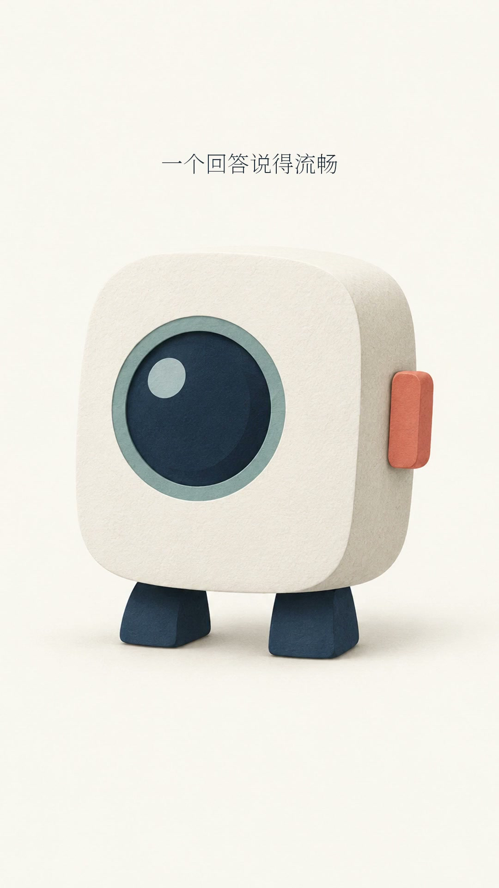

# 独立品牌示例：未见实验室

这是公开模板的虚构 AI 科普品牌示例。它展示如何把定位、视觉语法、可选角色、文稿和分镜联系起来；使用者可以整体替换品牌，不必使用相同颜色或角色。

- [品牌与角色 brief](brand-brief.md)
- [文稿、方法与语音节奏初审](review-initial.md)
- 实际图像、配音、配置、生成记录和视频以本目录最终收录的文件及其交付记录为准。

本示例的生成素材与可见声音配置用于演示已执行的一次制作，不能保证你所使用的账户也具备同样工具、声音或服务。仓库的 `studio.py demo` 是另一条独立的离线工程检查路线，使用程序样张和测试音频，不应与本示例的生成效果混淆。

## 看实际成片

[下载/查看 28.36 秒竖版示例](showcase.mp4) · [交付与检查结果](DELIVERY.md)

完整输入放在 `showcase-project/`：品牌参考、原稿、分镜、逐镜提示词、3 张 Codex 内置生图、1 张原创排版落版、本地配音、原生时间戳和真实审核报告。最终示例无 BGM；离线 demo 另外覆盖混音/让位功能。

## 从示例继续，而不是复制审核结论

在 Codex 打开仓库，发：

> 使用 $video-studio。先读取 examples/ai-explainer 的品牌、分镜和交付记录。为我的以下新文稿创建新一期；可以参考品牌，但不要沿用旧文稿、时间线或审核通过状态。文稿：……

如只复核已提供的素材，可用 `--project examples/ai-explainer/showcase-project` 指向示例项目；显式 episode 路径是 `examples/ai-explainer/showcase-project/episodes/ep-0001-evidence-first/episode.json`。先运行 `reviewed`，然后依次 `audio`、`fetch`、`timing`、`preview`。音频从已打包 WAV 导入，不再次付费。

下载后 run 目录是全新的，需要实际查看预演再填写本次预演审核，渲染后重新生成最终 QA 和字幕审核；不要直接把历史运行的通过状态当成本机通过。精确命令见[运行手册](../../docs/runtime.md)。

已有的生成图片可复用，但重新生成不会保证逐像素相同。内置图像工具的后端型号和 numeric seed 未公开确认，因此记录为 null。
